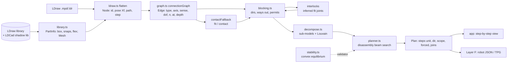

# Assembly planning: LDraw → a buildable sequence (System + Technic), robot-ready later

Target: big LDraw models such as the LEGO Icons 10317 Land Rover Defender (about 2,300 parts, heavy Technic). The 10317 file isn't in the repo. The ladder below uses corpus models of the same kind, up to 42055 (3,826 rigid parts), and `scripts/plan-bench.mjs path/to/10317.mpd` runs the same checks on any file.

Code: `src/engine/plan/`. Bench: `scripts/plan-bench.mjs`. Weight learning: `scripts/plan-tune.mjs`.

**Language:** TypeScript, not the Python the brief suggested. The engine, parser, catalog and instruction viewer are already TypeScript, and the planner has to feed the app's "build it step by step" view. The pieces are plain data in and out (nodes, edges, plans as JSON), so a Python robot stack (MoveIt/ROS) can consume them unchanged.

## 0. Research digest (Changliu Liu's lab, CMU, and the references the brief named)

Read in full text unless marked. "Verify" means the details weren't confirmed from the paper itself.

| work | what it does | what we took |
|---|---|---|
| **StableLego** (Liu, Deng, Wang, Liu; RA-L 9(11) 2024, arXiv 2402.10711) | Force equilibrium per brick: 3–4 contact points per knob, forces P/U/S/D/H/K, friction capacity T = 0.98 N. Equilibrium is put into the objective, so every query has an answer and the residual locates the failure (Gurobi). Accuracy 99.56% on 225 real builds. Only 1×X/2×X bricks, studs vertical. | Contact points at the stud rim with T = 0.98 N; equilibrium as a least-squares residual that names the weak part. |
| **BrickSim** (Wen et al., arXiv 2603.16853, 2026; venue: verify) | Convex QPs per stud connection (OSQP), a linear friction pyramid (μ 0.2), an overload ratio, and breakage as a minimal cut. 5 ms, 100% static accuracy on 150 builds of up to 30 bricks. | Making the problem convex instead of StableLego's bilinear complementarity, so no commercial solver is needed. |
| **Physics-aware combinatorial ASP with data-free action masking** (R. Liu et al., arXiv 2408.10162, RA-L 2025) | Masks: target, collision, inventory, operability (free to press), StableLego stability; the robot's press modelled as a virtual 1 kg brick. PPO over the masks; under 50 bricks. They show that a "path to ground" check alone misses 8–70% of failures. | The masks as hard filters inside our search; the press-load test (`extraLoad`). |
| **APEX-MR** (RSS 2025, arXiv 2503.15836, code MIT) | The plan comes from assembly by disassembly (DFS plus StableLego). An ILP assigns robots and support. The plan becomes a temporal plan graph and runs asynchronously on two arms. Per-step JSON: press point, support pose, manipulation type. | The plan output format for robots, and the TPG as Layer F's executor. |
| **BrickGPT** (Pun et al., ICCV 2025 best paper, arXiv 2505.05469) | An LLM proposes bricks one per line; rejection sampling plus physics rollback to the first unstable brick. Checking stability after every step over-constrains, because a structure can be unstable mid-build and stable when finished. | Check stability at step or sub-assembly boundaries, and roll back to the first failure. |
| **BrickWright** (arXiv 2610.31651; venue: verify) | An agent writes code against an API with typed connectors (BrickNet annotations); a validator checks collision, floaters and components. The validator, not the agent, is what makes builds 100% valid. Sequences are out of scope. | The LLM proposes and the solvers verify (§5). |
| **BrickCraft / -Duo, Eye-in-Finger, LEGO tool, LfD papers** | Long-horizon skills, an in-finger stud camera (about 2 mm tolerance), a 20 N insertion load, dual-arm support when a step would tip. | Layer F: insertion load, support assignment, fixtures. |
| **Assemble Them All** (Tian et al., TOG 41(6) 2022, arXiv 2211.03977) | Disassembly by physics: BFS over ± axis forces and torques, then progressive BFS over parts. Up to 235 parts, minutes; no gravity, no grippers. | The "try every part shallow first" loop. Short translations, depth two (slide out, then away) replace the simulation, because LDraw connectors give the axes. |
| **ASAP** (Tian et al., ICRA 2024, arXiv 2309.16909) | Disassembly tree search: an outside-in part choice (or a GNN), a physics path, gravity stability with a held set of 2–4 parts. Too slow beyond about 50 parts (4,190 s median for more than 30 parts). | The SelectPart → CheckAssemblable → CheckStable skeleton; "parts that must be held" as a cost. |
| **Wilson & Latombe**, "Geometric reasoning about mechanical assembly", AIJ 71(2) 1994 | Non-directional blocking graphs. Removable subsets are strongly connected components of the blocking graph; polynomial time. | Directional blocking restricted to the connector axes. |
| **Homem de Mello & Sanderson**, "AND/OR graph representation of assembly plans", IEEE T-RA 6(2) 1990 | All sequences in one AND/OR graph of subassembly splits. | Not built. It is exponential in general; we use it only within one sub-assembly level (§3 C). |
| **LTRON** (ECCV 2022, arXiv 2207.13738) | Reads LDCad SNAP_CYL/FGR from LDraw. | Confirms the shadow-library route. |

None of these handles Technic (pins, axles, gears) or plans sequences beyond about 300 parts. Planning the Defender means going past the published work on both counts.

## 1. Diagnosis of the system before this work

Measured with `scripts/plan-diagnose.mjs` on 7 corpus models, 32 to 3,928 parts, with their STEP lines stripped. The system was `engine/connect.ts` plus `engine/instructions.ts` plus `engine/stability.ts`.

| symptom | measured | root cause | impact |
|---|---|---|---|
| Joints untyped | 98% of the 9,048 links in 42055 were "box overlaps" (the probe sits inside the other part's box). No axis, DOF or kind; a pin, an axle and a gear look alike. | Connections inferred from bounding boxes and name regexes, no connector data. | **1** (everything downstream depends on it) |
| Insertion never checked | The planner places a part once it touches a placed part. Nothing asks whether it can get there. | No blocking or collision model at all. | **2** |
| Off-grid parts get one step each, O(n²) | 42055: 3,928 parts gave 3,928 steps in 122 s. 42043: 2,755 steps in 56 s. | Steps group by grid layer, and Technic is off-grid. | 3 |
| Stability counts studs only | The Legolization-style tree check gives Technic joints zero load capacity. | No joint model beyond studs. | 3 |
| Order unlike a designer's | Spearman ρ vs the booklet: 0.29 on the cottage 31009, −0.13 on 30190. | "Lowest first" is the only ordering signal. | 4 |
| (Our own bench) | The first Node run saw 85 parts instead of 15,746. | The catalog loads through `fetch`; scripts need the file shim (fixed in the bench). | — |

## 2. The architecture

Data between layers, all plain JSON-able:
- **`Node`** `{ i, id, color, xf: { R[9], t[3] } (LDU, −y up), path: "sub#1/wheel#3", step }`
- **`Snap`** `{ kind: cyl|clip|finger|ball, gender, shape: R|A|S, radius, length, caps, pos, axis }`
- **`Edge`** `{ a (male), b, type: stud|pin|axle|axleFree|bar|hinge|ball|gear|fit|contact, axis, sense: 1|0|any, dof, n, at[], depth, friction }`
- **`Blocking`** `{ dirs[i]: Vec3[], ways(i,k): number[][], blockers(i,k), groupWays(group,d), permits(edge, moving, d) }`
- **`Plan`** `{ steps: { unit[], dir, scope, forced?, joins? }[], violations, clusters, ms }`
- **`Validator`** `{ name, check(present[]): cost }` — Infinity rejects

## 3. The layers

### A — Geometry and the connectivity graph (`library.ts`, `ldraw.ts`, `graph.ts`)

**Parsing.**
- Type-1 lines with 3×3 matrices, LDU units (stud 20, plate 8, brick 24), −y up.
- MPD `FILE` sections are flattened, keeping the sub-model path. A part embedded in the file (LDraw.org header or its own geometry) is reported as unknown rather than walked.
- STEP lines are counted the way a booklet walks the model: a reused sub-model goes on in a single step.
- `~Moved to` stubs take the target's name.
- Flexible segments (hoses, cables, strings) are left out and counted, to be routed by hand at the end. 42043 has 4,335 of them.

**Connectors, a hybrid of the three options in the brief:**
1. **The LDCad shadow library** (CC BY-SA 4.0, 4,285 files): SNAP_CYL (gender, sections, caps, grid, scale), SNAP_CLP, SNAP_FGR, SNAP_GEN (ball), SNAP_INCL and SNAP_CLEAR. Snaps are inherited through every referenced file with its matrix: stud.dat, connhole.dat, axle.dat stretched to length (`scale=YOnly`), subparts.
2. **LDraw primitives** come through the same inheritance, because the shadow library annotates the primitives themselves (p/stud.dat, p/axlehole.dat…).
3. **Geometry fallbacks:**
   - box contact, for parts no connector reaches: "fit" when one part is inside the other (tyre on rim, glass in frame), else "contact" (one resting on the other);
   - inferred interlocks from the blocking geometry (below).

**Matching:** a male cylinder and a female one of another part, coaxial (|cos| > 0.98, axis offset < 1.5 LDU), radius within 1 LDU, overlapping at least 2 LDU, with compatible sections.

| type | rule | DOF |
|---|---|---|
| stud | round r6, ≤ 8 long, capped | rigid (clutch) |
| pin | round r6, longer, in a round hole | rotation about the axis |
| axle | cross in cross | slides, no rotation |
| axleFree | cross in round | slides and rotates |
| bar | r4 in a bar hole or a clip | rotates (and slides) |

Hinges are coaxial finger sets of opposite gender. Balls are M/F spheres of one size at one point. Gears are paired by name: parallel axes, coplanar, centres (z₁+z₂)·1.25 LDU apart (8+24 = 2 studs); bevel and worm gears are skipped for now.

**The sense** of each joint, i.e. which way the parts separate: from the capped connector's start toward its far end. The stud's top cap, or the closed end of an anti-stud, set it; uncapped means either way along the axis. When the connectors of one pair disagree (a pin's capped half and its full length), the joint allows either way.

**Measured:** 42043 (2,752 rigid parts) gave 3,761 typed edges in 141 ms:

| type | edges |
|---|---|
| pin | 1,986 |
| axle | 1,024 |
| axleFree | 634 |
| bar | 41 |
| stud | 39 |
| ball | 24 |
| gear | 13 |

43 parts had no connector (1.6%) and went to the fallback.

### B — Hierarchical decomposition (`decompose.ts`, `planner.ts`)

**First source: the file's own sub-models.** The designer's FILE sections are the best prior there is. Each instance is planned once, on its own, then placed as one rigid unit in its parent, recursively.

**For a scope with more than 150 loose parts and no sub-models:** Louvain communities on the joint graph, weighted by strength (stud ×n, axle 3, pin 2, axleFree 1.5, contact 0.3, gear 0), split again while too big. A community is kept as a sub-assembly only if all of these hold:
- (a) it is connected;
- (b) it has 20–150 parts;
- (c) all its joints to the rest let it come off along one shared direction.

Otherwise its parts stay loose. On 42064, 3 communities passed. Plan-time validation then catches the rest: a unit that can't come off is reported as forced.

**Not built:** spectral clustering and min-cut. Louvain plus the sub-model prior covers the ladder. Min-cut on the liaison graph is the next candidate for big flat Technic frames (§7).

### C — Sequence planning (`blocking.ts`, `planner.ts`)

**Assembly by disassembly.** Disassembly from the finished model is monotone: taking a part off never makes another harder to take off. So a greedy beam never dead-ends except on a false block, a missed joint, or the connectivity preference. That is why the forced count works as a measure of the checker's own errors.

**Directions:** each part's candidate directions are its joints' axes (±, by sense) plus the six world axes. At any moment, a direction is open only if every remaining joint permits it: the directional blocking graph (Wilson & Latombe) restricted to connector axes, which keeps it at a handful of directions per part.

**Ways out (two legs).** Requiring a straight sweep to infinity flagged too many real steps as impossible: 25% of the booklet's steps on 42064. The rule now:
1. Slide out of the joints: the stud height, or for a pin, axle or bar the part's own length along the axis.
2. Then leave along d or any of the six axes. This is Assemble Them All's depth-two translations, without the simulation.

Each way is the set of parts that must already be gone.

**Collision test:**
- Broad phase: oriented boxes (separating axes), the swept box stretched along the part's own axis, else a conservative swept AABB.
- Narrow phase: rays from each part's vertices, pulled in 0.75 LDU, against the other's triangles in a BVH, and back. Hits nearer than 2 LDU count as touching; rays running along a face are ignored.
- Joint partners that permit the direction are skipped on the first leg.
- Boxes that overlap where they stand (a figure in a hollow cabin) are left to the meshes.

**Inferred joints:** two parts that block each other along every direction are interlocked in a way no connector describes (a door in its frame, a bush on a hidden axle). They become "fit" joints. There were 80 on 42064.

**Search:**
- A beam of partial plans (width 4); a removal's score combines height, outward, same direction, near the last, leaf-ness, and a cost for splitting the build into pieces.
- Validators (stability, robot checks) are added every `checkEvery` removals.
- If the best state is stuck, the least-blocked unit comes off anyway and is recorded as `forced` with the reason.

**Complexity:**

| part | cost |
|---|---|
| graph | O(S) snaps with a spatial hash |
| blocking | lazy, per part × direction × way |
| broad phase | O(n_local) per sweep |
| narrow phase | O(V log T) |
| plan | O(n · units_in_scope · dirs) with beam B |

The sub-model hierarchy keeps units_in_scope small. Nothing here is exponential. An AND/OR graph would be, so it is only worth it within one small scope, to enumerate alternative orders (not built).

**Technic specifics:**
- An axle through several beams: the two-leg rule makes it slide its own length, so it must go in before the beams that would trap both ends, or after one side is open.
- Gears: meshes are recorded (`gear` edges) but don't constrain motion. Inserting a gear along its axle while its mate is present is allowed.
- Captive parts show up as mutual all-direction blocks, so they become inferred fits and are put on together.

**Learned heuristic (not built):** a GNN predicting removability or step cost on the typed graph. The bench's ground truth (official orders and false-alarm labels) is the training data it would need (§7).

### D — Stability and feasibility (`stability.ts`)

**Formulation:**
- Unknowns x: contact forces.
- Per part: Σ forces + weight = 0 and Σ moments = 0 (6 rows).
- Solve min ‖A x − b‖² subject to l ≤ x ≤ u.
- Solver: an active set on the bounds, with column-scaled CGLS on the free variables. Convex, no external solver.
- A part left with more than 5% of its weight (or 5 mN) unbalanced is unstable. How close the joints run to their limits is the margin.

**Joint models:**

| joint | model |
|---|---|
| stud | 4 rim points with an axial force each: compression free, tension ≥ −0.98 N (StableLego). Lateral force free (interlock). |
| pin, axleFree, bar, hinge | Lateral forces at two points along the axis (so the joint takes bending). Axial friction ±2 N (friction pin) or ±0.3 N (smooth); turning friction 0.5 or 0 N·cm. |
| axle | Free torque about the axis. |
| ball | Free force; torque ±4 N·cm. |
| fit | Held, with a modest moment. |
| contact | Compression only. |
| table | Compression at the bottom corners of every part at the lowest level. |

Mass: 0.47 mg per mm³ of the part's box (a 2×4 brick is 2.32 g). **Assumptions:** the pin, axle and ball numbers are estimates and should be measured, for example by pull-tests as BrickSim did.

**Load cases:** `extraLoad` puts a press force on a part. Use 20 N, as in BrickCraft-Duo, for a robot's insertion; on failure, assign support or a hand-hold.

**Rigidity and mechanism analysis (designed, not built):** the joint DOFs are in the graph, and a build's free modes are the null space of the joint constraint Jacobian. A smooth pin alone gives one rotational mode, which the stability rows already show as a moment that can't be balanced. Checking rank on the 6n kinematic rows is the clean way to report "this swings", separately from "this falls".

**Robot hooks:** the step's insertion direction and the press force above. Gripper clearance is the same ray test, run on a gripper mesh. Each is a pluggable `Validator`.

### E — What a good plan is

Cost per removal (reversed, per insertion):

> −(w_h·height + w_o·outward + w_d·sameDirection + w_n·nearLast + w_l·leaf) + w_split·[splits the build] + 10·[forced] + validators

Bench metrics:

| metric | meaning |
|---|---|
| reorientations | changes of insertion direction within a scope |
| joinsPieces | steps that join separate pieces |
| forced | relaxed constraints |
| stability | unstable sampled partial builds, minimum margin |
| ρ vs booklet | human-likeness |

**Learning the weights** (`plan-tune.mjs`): 24 corpus models with booklet steps, 60–400 parts, split by name hash into 17 for training and 7 held out. Coordinate ascent took the training ρ from 0.487 to 0.622, but the held-out ρ went from 0.569 to 0.534. It **overfits**, so the hand weights stay the defaults. A learned model needs more signal: per-step features (part category, sub-model, layer) and pairwise ranking on many more models, not six scalar weights on 17.

### F — Perception and execution (outline)

- **Kitting:** sort parts by step from the plan (part, colour, count).
- **Perception:**
  - Synthetic data: render the flattened nodes with domain randomisation (lighting, backgrounds, camera, part colour noise); our renderer can already draw any LDraw part.
  - Part classification plus 6D pose estimation, refined at the gripper with an in-finger stud camera (Eye-in-Finger shows about 2 mm tolerance).
- **Execution:**
  - The plan becomes per-step JSON (APEX-MR's schema: pick, press point/side, support pose, manipulation type), then a temporal plan graph for asynchronous dual-arm execution.
  - Motion: MoveIt / sampling-based planners.
  - Insertion: force-controlled, learned by imitation (Diffusion Policy with force input, as in BrickCraft), with the press load checked by `extraLoad` beforehand.
  - Closed loop: visual check after each step against a render of the expected state. On a mismatch, take the step's parts off by the plan's reverse and retry.

## 4. Benchmark ladder (`scripts/plan-bench.mjs`)

Unit tests, all 8 passing:
- a tower of 3 has 2 stud joints of 8 studs each;
- the bottom brick is blocked upward by the one above, and the top one is free;
- the tower is planned bottom-up and stands;
- a 1×8 plate held by one stud holds without load and comes off under 3 N on its tip;
- a brick in mid-air falls.

Ladder: 30190 (32 parts), 31009 cottage (260, System), 42021 (183, Technic, no steps), 42064 (1,316), 8258 (1,663), 42043 Arocs (2,752 rigid + 4,335 flexible), 42055 (3,826). The table is filled from `bench/results/plan-ladder.json`:

| model | parts | typed edges | inferred | forced | official✗ | ρ (file order) | unstable / sampled | reorient | ms total |
|---|---|---|---|---|---|---|---|---|---|
| 30190-1 | 32 | 33 | 2 | 0 | 12.5% | 0.21 (0.987) | 0/1 | 4 | 92 |
| 31009-1-310091 | 260 | 342 | 2 | 3 | 3.1% | 0.52 (1) | 1/1 | 12 | 524 |
| 42021-1-420211 | 183 | 220 | 8 | 20 | 4.9% | None (None) | 12/12 | 35 | 904 |
| 42064-1 | 1316 | 1655 | 80 | 81 | 19.2% | -0.122 (1) | 2/3 | 277 | 12465 |
| 8258-1 | 1663 | 2271 | 82 | 124 | 24.8% | 0.245 (1) | 1/1 | 315 | 14507 |
| 42043-1-420431 | 2752 | 3761 | 124 | 89 | 21.4% | 0.361 (1) | 12/12 | 489 | 33531 |
| 42055-1 | 3826 | 5102 | 127 | 118 | 14.0% | 0.22 (1) | 2/2 | 584 | 57712 |

Stability: the sampled partial builds of the Technic models come out unstable almost everywhere. The pin/axle strengths are estimates, and missed joints leave parts unsupported. Until both are calibrated, the stability column isn't a trustworthy signal for Technic (fix 6 and the calibration row in §7). The System models' results are credible.

Columns:
- **forced:** removals where a constraint had to be relaxed. These are the checker's own errors or missed joints.
- **official✗:** the booklet's steps our checks call impossible (false alarms). A step's parts may go on in any order.
- **ρ:** Spearman, our order vs the booklet's.
- **unstable:** sampled partial builds that don't stand.

## 5. LLMs vs algorithms

| task | who | why |
|---|---|---|
| Parse, connect, block, plan, stability | solvers | Needs geometric precision and guarantees; milliseconds; reproducible. |
| Naming sub-assemblies and chapters ("rear axle", "gearbox") | LLM | Semantic, cheap to verify (only labels). |
| Proposing decompositions when Louvain and sub-models disagree | LLM proposes, Layer B validates (connected, removable, size) | BrickWright's lesson: the validator, not the agent, makes it valid. |
| Reading official instruction images (MEPNet-style) to give order priors | VLM | Turns booklets into Layer E training data. |
| Explaining failures ("the axle must go in before beam 32525 closes the gap") | LLM over the `forced` record and its blockers | Language only, on facts the solver produced. |
| Orchestrating the robot loop, recovery choices | LLM with tools | High-level; each action is checked by the validators before it runs. |

**The loop:**
1. The LLM proposes (a decomposition, an order prior, a recovery).
2. The solvers verify (blocking, stability, robot validators).
3. Failures go back to the LLM as structured facts (part ids, directions, blocker sets).
4. The LLM revises. Cap the rounds; the plan of record is always solver-checked.

## 6. Ranked fixes (quick wins first)

1. **Done:** typed connectors from the shadow library. Before, 98% of links were untyped box overlaps; now 98.4% of parts have typed joints.
2. **Done:** directional blocking with two-leg ways out and a mesh narrow phase. Previously insertion was never checked.
3. **Done:** the planner over sub-models; 3,826 parts plan in seconds. Next: fold `planInstructions` onto it for imported models without steps.
4. **Next, quick:** steps from the plan. Group consecutive insertions that share scope and direction and are close together, 3–6 parts each, the corpus median (to measure). Today it is one unit per step.
5. **Next, quick:** use the file's own order as a prior when it has steps (ρ is about 1.0 with the booklet on every corpus file), and plan only to check it. For a Studio or LEGO-exported Defender this is likely the best plan available.
6. **Next:** recover the missed joints that drive the remaining false alarms on Technic: two pins pointing different ways into one part, panels, bevel and worm gears, Technic bushes without shadow data. Each inferred fit is a pointer to one.
7. **Next:** the mechanism check (rank of the joint Jacobian) and robot validators (gripper clearance by the same ray test, press load 20 N, flips counted).
8. **Later:** a learned ordering model (pairwise ranking on per-step features), trained on the corpus booklets with held-out evaluation.

## 7. Open problems and ideas

| idea | difficulty | payoff |
|---|---|---|
| Exact swept-volume collision (convex decomposition per part, GJK along the path) instead of vertex rays: no missed edge–edge contacts, no tolerance knobs | medium | high: false alarms are the main error left |
| A GNN on the typed graph predicting removability and booklet rank, trained on ~550 corpus booklets; used as the beam's score with the solvers still deciding | medium–high | high: human-likeness (ρ ≈ 0.5 now) |
| Min-cut sub-assemblies for flat Technic frames (min weighted cut with the "removable as a unit" constraint) | medium | medium–high: fewer forced steps, booklet-like chapters |
| Captive and simultaneous insertions (a pin and the beam that traps it; two gears meshing as they go in): detect strongly connected blocking components and plan them as one compound move | high | high for gearboxes |
| Mechanisms: plan the gearbox so it turns when finished (gear trains as constraints; check the mesh before closing the housing) | high | high for the Defender's drivetrain |
| Flexible parts: route hoses and cables from their segments as one part with a path, inserted after its end connectors | medium | medium |
| Calibrated joint strengths (pin, axle, clip, ball) from pull tests or BrickSim data, replacing the assumptions in `stability.ts` | low–medium | medium |
| Robot-aware cost: reorientations with the real fixture, grasp sets per part, dual-arm support from the stability margin | medium | needed for Layer F |
| VLM reading of instruction PDFs (we already read 75325's this way) into step labels for models without STEP lines | medium | high: more training data |

## Assumptions

- LDraw axes and units as stated. The table is the lowest y.
- The shadow library is CC BY-SA 4.0. Any connector table derived from it and shipped in the app must carry the same licence and credit; the planner reads it from `booklets/shadow` (git-ignored, downloaded) and ships nothing.
- Official LDraw steps are taken as feasible. A booklet step may add its parts in any order.
- Joint strengths other than studs are estimates (see `stability.ts`).
